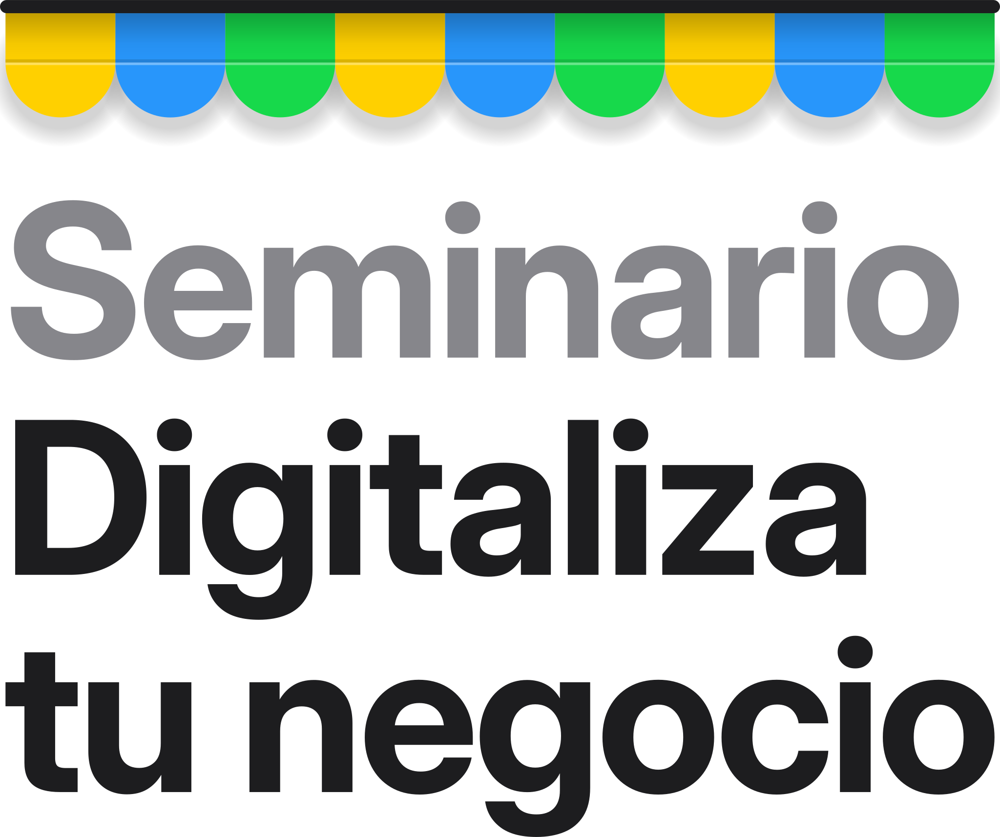
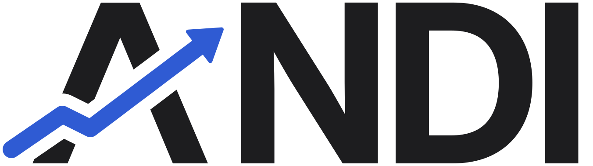

# Identidad visual

Para cuando el texto va dentro de una imagen, un video o una página.

## Seminario Digitaliza tu Negocio

- **Logo:** un toldo de tienda con franjas amarilla, azul y verde, y debajo «Seminario» (en gris) + «Digitaliza tu negocio» (en negro). Hay versión apilada, en línea e ícono en [imagenes/marca/](imagenes/marca/).
- **El logo nunca va chiquito.** Siempre ocupa el ancho que tiene disponible.
- **Fondo:** blanco o gris muy claro (#F5F5F7). Para que no se vea plano se usa una cuadrícula suave y manchas de luz de los tres colores.
- **Tinta:** #1D1D1F. **Gris de texto:** #6E6E73.
- **Letra:** Inter, en negrita para los títulos.
- **Colores de HighLevel**, cada uno con su papel:
  - Verde #17D94B: el seminario (el interruptor encendido). Es el principal.
  - Azul #2896FB: la información (fecha y hora).
  - Amarillo #FFD000: el VIP de la versión presencial. Se dice «amarillo», nunca «dorado».
  - Sobre estos colores la letra va negra; la blanca no se lee.
- **La firma:**
  - El **interruptor de iPhone encendido** (verde), al final del título.
  - **Títulos que terminan en punto**, con la segunda línea en gris: «Enciende tu negocio / en internet.»
  - El toldo como «tapa de tienda» arriba de las piezas.

## Sistema ANDI

Tiene su propia marca (logotipo y símbolo en [imagenes/marca/](imagenes/marca/)), con un azul de acento #2F5BD3. Cada clase de la semana tiene su color. Se usa solo en la oferta, nunca en las piezas del seminario.
