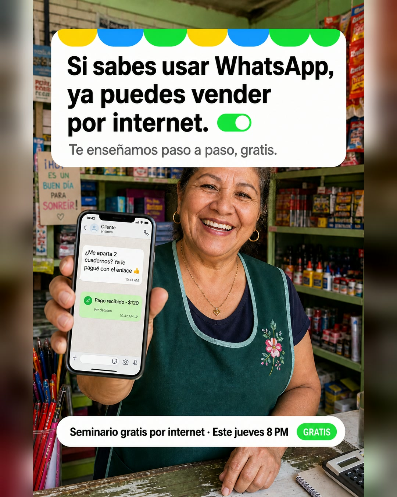
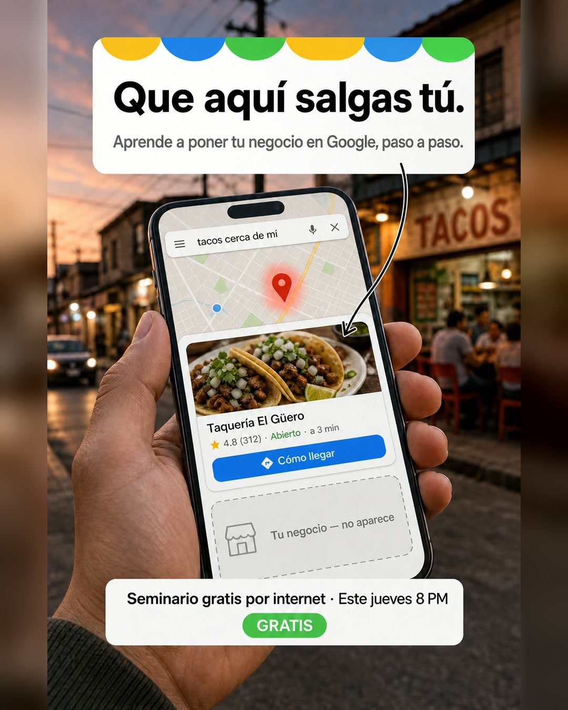
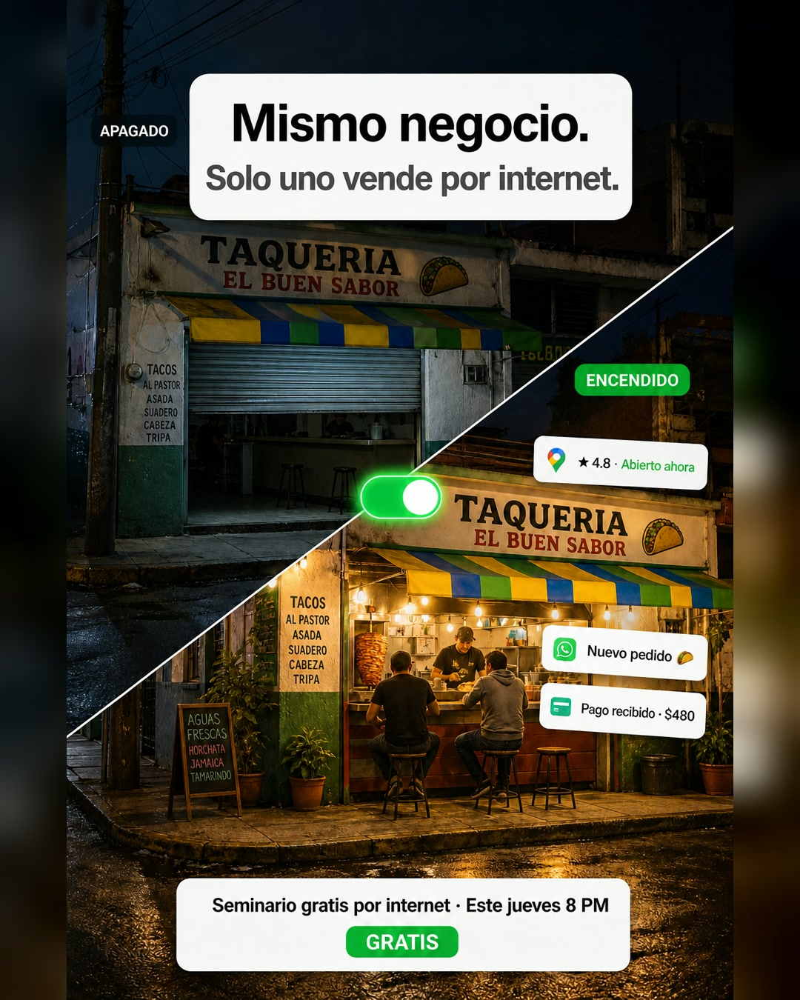

# Anuncios de imagen (Meta)

Destino: https://www.sinergeticos.com/digitaliza-tu-negocio · Botón: **Registrarte**

Cada anuncio tiene un formato para el feed (4:5) y otro para historias y reels (9:16) en [../imagenes/anuncios/](../imagenes/anuncios/). Son cinco conceptos distintos, con persona y escena distintas.

Orden en la lectura de prueba (una dueña de taquería, 47 años, Zapopan): **1 > 2 > 4 > 3 > 5**. Se sugiere lanzar el 1, el 2 y el 3 juntos. Todavía no hay resultados de campaña.

---

## 1 · Si sabes usar WhatsApp, ya puedes vender por internet ⭐

**Apuesta:** quitarle el miedo a la gente de 45 años en adelante.

¿Tus hijos no tienen paciencia para enseñarte cómo usar el internet para tu negocio?

Aquí te lo explicamos paso a paso, con palabras de todos los días.

Este jueves, gratis y por internet: cómo aparecer en Google, contestar WhatsApp sin estar pegada al celular y cobrar con un enlace.

Si sabes usar WhatsApp, ya puedes vender por internet.

📅 Este jueves · 8 PM (hora de CDMX y Guadalajara)
🎟 Gratis · desde tu celular

**Titular:** Ya puedes vender por internet

> El copy anterior decía «Si sabes usar WhatsApp, puedes» y se corrigió porque quedaba en el aire: «¿puedes qué?».

---

## 2 · Que aquí salgas tú ✅ aprobado

**Apuesta:** la escena concreta de Google Maps, contada como aspiración.

Cuando alguien busca lo que vendes, el primero que sale en Google se queda con el cliente: fotos, reseñas, horario y un botón para llegar.

Ese lugar puede ser tuyo. Este jueves, en un seminario gratis por internet, aprendes a poner tu negocio en Google paso a paso, con tu celular.

📅 Este jueves · 8 PM (hora de CDMX y Guadalajara)
🎟 Gratis · desde tu celular

**Titular:** Que te encuentren a ti

**Texto en la imagen:** «Que aquí salgas tú. / Aprende a poner tu negocio en Google, paso a paso.», con una flecha al primer resultado de Google Maps.

> La versión anterior («Te están buscando. ¿Por qué le sale el de enfrente?») se sentía rara. Ganó la aspiración sobre el reproche.

---

## 3 · Mismo negocio. Solo uno vende por internet

**Apuesta:** el contraste entre un negocio apagado y uno encendido, sin culpa.

El de enfrente vende lo mismo que tú. La diferencia es que a él lo encuentran en Google, le escriben por WhatsApp y le pagan con un enlace.

Este jueves te enseñamos a hacer lo mismo con tu negocio. Gratis, por internet y con lo que ya tienes: tu negocio y tu celular.

📅 Este jueves · 8 PM (hora de CDMX y Guadalajara)
🎟 Gratis

Toca Registrarte y te mandamos el enlace por WhatsApp.

**Titular:** Enciende tu negocio en internet

---

## 4 · Ya cerraste. Tu WhatsApp sigue atendiendo

**Apuesta:** el deseo de descansar sin perder ventas.

Ya cerraste y sigues contestando WhatsApp desde la cama.

Imagina que tu WhatsApp contesta los «¿a qué hora abren?» y manda tu catálogo solo, para que mañana empieces el día con pedidos apartados.

Este jueves te enseñamos a armarlo con tu celular, gratis y por internet.

📅 Este jueves · 8 PM (hora de CDMX y Guadalajara)
🎟 Gratis

**Titular:** Que tu WhatsApp conteste solo

> La imagen muestra a un hombre dormido. Ni la imagen ni el texto dicen «dormido», para no excluir a las mujeres.

---

## 5 · Este jueves pon tu negocio en internet

**Apuesta:** la autoridad de Manuel y la energía de un evento en vivo.

Este jueves, en vivo y por internet, Manuel de León enseña a dueños de negocio a aparecer en Google, contestar WhatsApp solo y cobrar con un enlace.

Explicado para quien no tiene tiempo para cursos. Gratis.

📅 Este jueves · 8 PM (hora de CDMX y Guadalajara)
💻 Desde tu celular o tu computadora

**Titular:** Gratis este jueves, 8 PM

---

## Ideas que quedaron en el banco (sin imagen)

- **Cobros:** «¿Sigues persiguiendo transferencias para que te paguen? Mandas un enlace por WhatsApp y te pagan con tarjeta desde su celular.» Titular: «Cobra con un enlace».
- **WhatsApp a las 11 de la noche:** «Contestas WhatsApp a las 11 de la noche y aun así se te van clientes. Mientras atiendes, los mensajes esperan. Y el cliente que espera, compra en otro lado.»
- **El internet no es solo para jóvenes:** «¿Sientes que el internet ya es solo para los jóvenes? No te faltan ganas. Te faltó que alguien te lo explicara paso a paso, sin palabras raras.»
